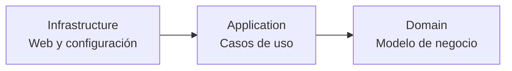

# Pokémart

**Aplicación web de gestión de Pokémon, desarrollada con Java y Spring Boot.**

Este proyecto permite crear Pokémon desde un formulario web y consultar una lista de tres Pokémon de ejemplo. También incluye rutas para probar la modificación y eliminación de Pokémon. El objetivo de la práctica es aplicar una organización modular con **Vertical Slicing** y la separación de responsabilidades de **Clean Architecture**.

## Tecnologías

Java 17 · Spring Boot · Spring MVC · Maven · Lombok · HTML

## Funcionalidades implementadas

- **Crear Pokémon:** formulario HTML que envía una petición `POST /pokemons`.
- **Listar Pokémon:** petición `GET /pokemons` que muestra tres Pokémon estáticos en HTML.
- **Modificar Pokémon (prueba):** petición `PUT /pokemons/{id}` que recibe el ID y los datos, y devuelve un resultado sin actualizar datos almacenados.
- **Eliminar Pokémon (prueba):** petición `DELETE /pokemons/{id}` que transmite el ID hasta el UseCase y responde con `204 No Content`, sin borrar datos almacenados.

> **Estado actual:** los Pokémon creados no se almacenan en una base de datos y no aparecen posteriormente en el listado. La lista de ejemplo se genera de nuevo en cada petición GET. Las operaciones PUT y DELETE sirven para comprobar el flujo y los parámetros de las peticiones, pero no modifican ni eliminan registros persistentes.

## Ejecutar el proyecto

1. Abrir el proyecto en el IDE y ejecutar la clase `StoreApplication.java` (o ejecutar `sh ./mvnw spring-boot:run` en Linux; `mvnw.cmd spring-boot:run` en Windows).
2. Abrir el formulario: <http://localhost:8080/formulario-crear-pokemon.html>.
3. Rellenar el formulario y pulsar **Crear Pokemon** para probar `POST /pokemons`.
4. Visitar <http://localhost:8080/pokemons> para consultar el listado mediante GET.
5. Para probar PUT y DELETE, utilizar los comandos de las guías de [modificación](documentation/editar.md) y [eliminación](documentation/eliminar.md), y comprobar los parámetros en Debug.

## Arquitectura

El módulo **Pokémon** agrupa la funcionalidad relacionada con este recurso (**Vertical Slicing**) y se organiza en tres capas:

Las flechas representan las dependencias principales entre capas, no el orden exacto de ejecución de las peticiones.

## Documentación

- [Arquitectura y decisiones de diseño](documentation/arquitectura.md)
- [Creación de Pokémon — POST](documentation/crear.md)
- [Listado de Pokémon — GET](documentation/listar.md)
- [Modificación de Pokémon — PUT](documentation/editar.md)
- [Eliminación de Pokémon — DELETE](documentation/eliminar.md)
