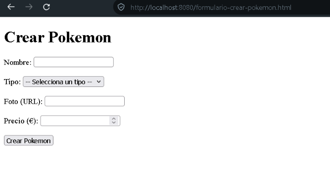
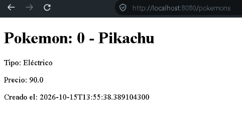

# Crear Pokémon — POST

La aplicación permite introducir un Pokémon mediante un formulario HTML. El navegador envía sus datos a `POST /pokemons`.

## Cómo probarlo

1. Iniciar `StoreApplication.java` (la aplicación escucha en el puerto `8080`).
2. Abrir <http://localhost:8080/formulario-crear-pokemon.html>.
3. Rellenar los campos y pulsar **Crear Pokemon**.
4. El navegador recibe una página HTML con los datos del Pokémon creado.

## Cómo funciona

El Controller recibe `PokemonRequest` y el Mapper lo transforma en `CreatePokemonCommand`. Después, `CreatePokemonService` llama a `CreatePokemonUseCase`, que crea el objeto con `Pokemon.builder()` y devuelve el resultado al Controller.

**Limitación actual:** el Pokémon no se almacena en una base de datos.

[← Volver al README](../README.md)
