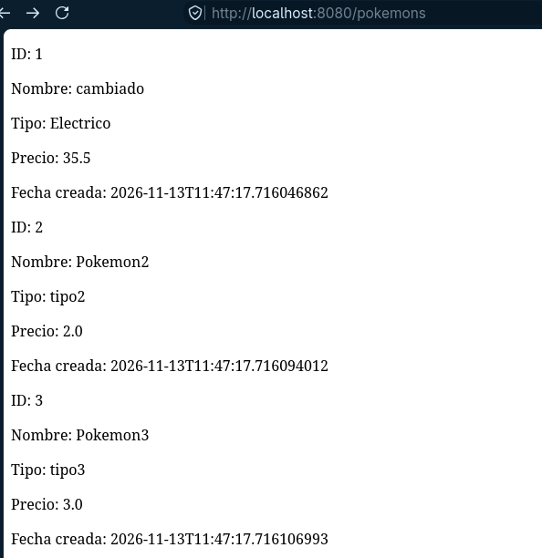

# Modificar Pokémon — PUT

Esta práctica permite recibir el **ID** del Pokémon desde la ruta y los **nuevos datos** desde el cuerpo de la petición.

- Ruta: `PUT /pokemons/{id}`
- Controller: `@PutMapping("/{id}")`, `@PathVariable int id`, `@RequestBody PokemonRequest`
- Flujo: `PokemonController` → `PokemonMapper.toCommand(id, request)` → `EditPokemonService` → `EditPokemonUseCase`.

## Cómo probarlo

Iniciar `StoreApplication.java` y ejecutar en una terminal:

```bash
curl -i -X PUT http://localhost:8080/pokemons/1 \
  -H "Content-Type: application/json" \
  -d '{"nombre":"cambiado","tipo":"Electrico","foto":"https://ejemplo.com/pikachu.png","precio":35.5}'
```

Debería de verse los resultados en <http://localhost:8080/pokemons>.



## Gestión de validación

La aplicación esta preparada para mostrar un mensaje de error dependiendo de los siguientes casos:

- El nombre del Pokémon no puede estar **vacío**. Tampoco  puede tener un **salto de línea ni espacio  en blanco**.
- El tipo del Pokémon no puede estar **vacío**.
- El preciod el Pokémon no puede estar ni por debajo de 0 ni por encima de 100.
