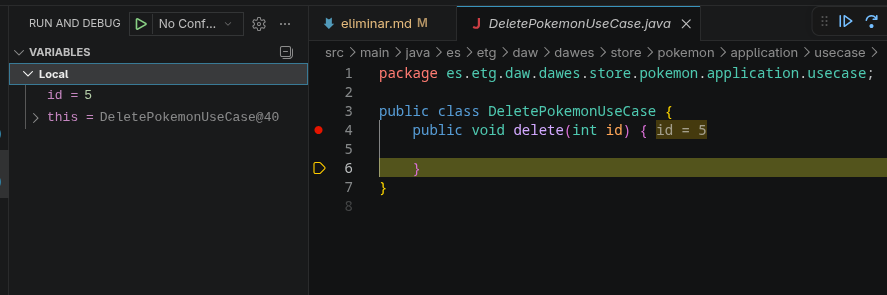
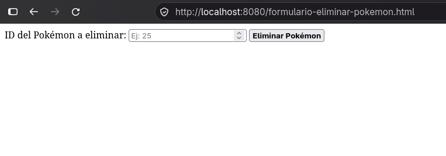

# Eliminar Pokémon — DELETE

La petición identifica el Pokémon que queremos eliminar mediante un parámetro de ruta: `DELETE /pokemons/{id}`.

- Controller: `@DeleteMapping("/{id}")` y `@PathVariable int id`.
- Flujo: `PokemonController` → `DeletePokemonService` → `DeletePokemonUseCase`.
- Respuesta actual: `204 No Content`.

## Cómo probarlo con curl

Iniciar `StoreApplication.java` y ejecutar:

```bash
curl -i -X DELETE http://localhost:8080/pokemons/5
```

En **Debug**, colocar un breakpoint en `DeletePokemonUseCase.delete(int id)` y comprobar que llega `id = 5`.



## Alternativa: formulario HTML

Iniciar `StoreApplication.java` e introducir la siguiente dirección en tu navegador:

<http://localhost:8080/formulario-eliminar-pokemon.html>

Deberías ver el siguiente formulario:



En **Debug**, colocar un breakpoint en `DeletePokemonUseCase.delete(int id)` y comprobar que llega `id = 5`.


[← Volver al README](../README.md)
