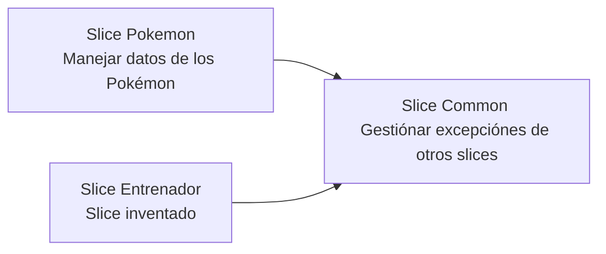

# Gestionar errores con slice common

Se ha implementado un nuevo slice (common) para manejar las excepciónes de otros slices(como Pokemón), como puede ser **NullPointerException.java**(evitando implementar la gestión de excepciónes en el slice Pokémon, ya que haría el resto de slices dependiente de este).

