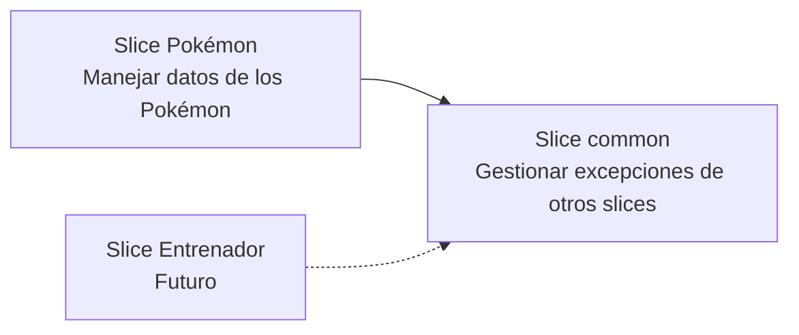

# Gestionar errores con slice common

El slice `common` permite manejar las excepciones de otros slices (como Pokémon o, en el futuro, Entrenador), por ejemplo `NullPointerException`, evitando implementar la gestión de errores en el slice Pokémon y hacer que los demás slices dependan de él.

