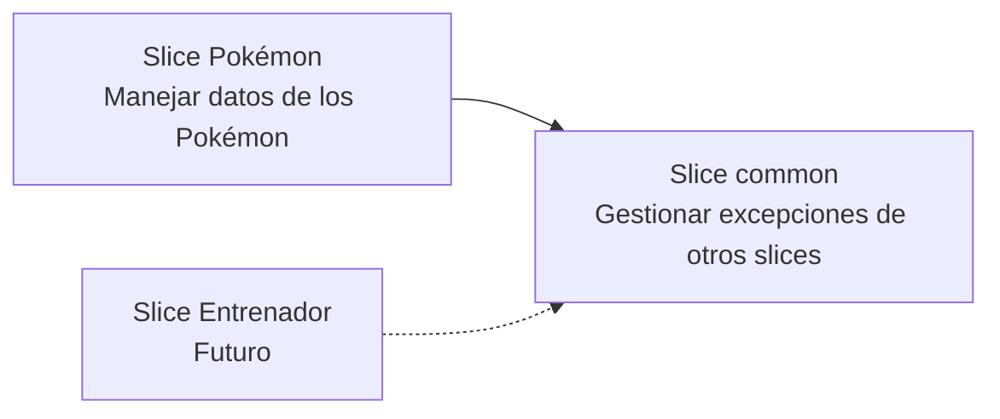

# Gestionar errores con slice common

El slice `common` permite manejar las excepciones de otros slices (como Pokémon o, en el futuro, Entrenador), por ejemplo `NullPointerException`, evitando implementar la gestión de errores en el slice Pokémon y hacer que los demás slices dependan de él.

## Validaciones

La aplicación esta preparada para mostrar un mensaje de error dependiendo de los siguientes casos:

- El nombre del Pokémon no puede estar **vacío**. Tampoco  puede tener un **salto de línea ni espacio  en blanco**.
- El tipo del Pokémon no puede estar **vacío**.
- El precio del Pokémon no puede estar ni por debajo de 0 ni por encima de 100.

Los mensajes están definidos en `messages.properties`.