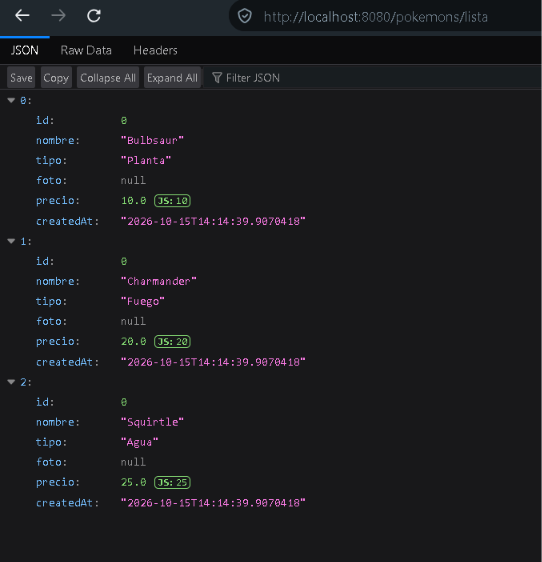

# Listar Pokémon — GET

El listado de prueba muestra tres Pokémon estáticos: Bulbsaur, Charmander y Squirtle.

## Cómo probarlo

1. Iniciar `StoreApplication.java`.
2. Abrir <http://localhost:8080/pokemons>.
3. El Controller devuelve una página HTML con los tres Pokémon.

## Cómo funciona

`PokemonController` atiende `GET /pokemons` y llama a `ListPokemonService`, que delega en `FindPokemonUseCase`. El UseCase crea los tres objetos y devuelve una lista al Controller. Finalmente, el Controller genera el HTML con `StringBuilder` y un `for-each`.

**Limitación actual:** la lista se vuelve a crear en cada petición y no incluye los Pokémon enviados por POST.

[← Volver al README](../README.md)
